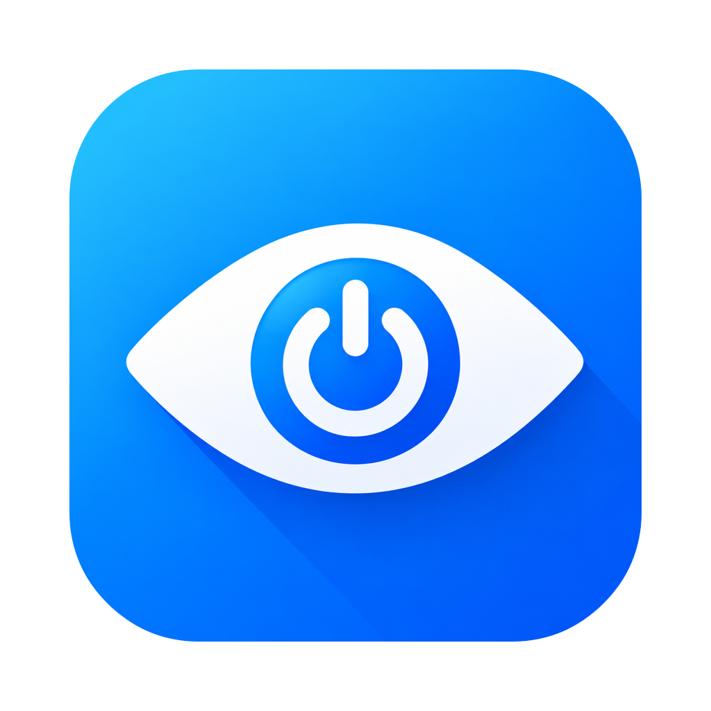
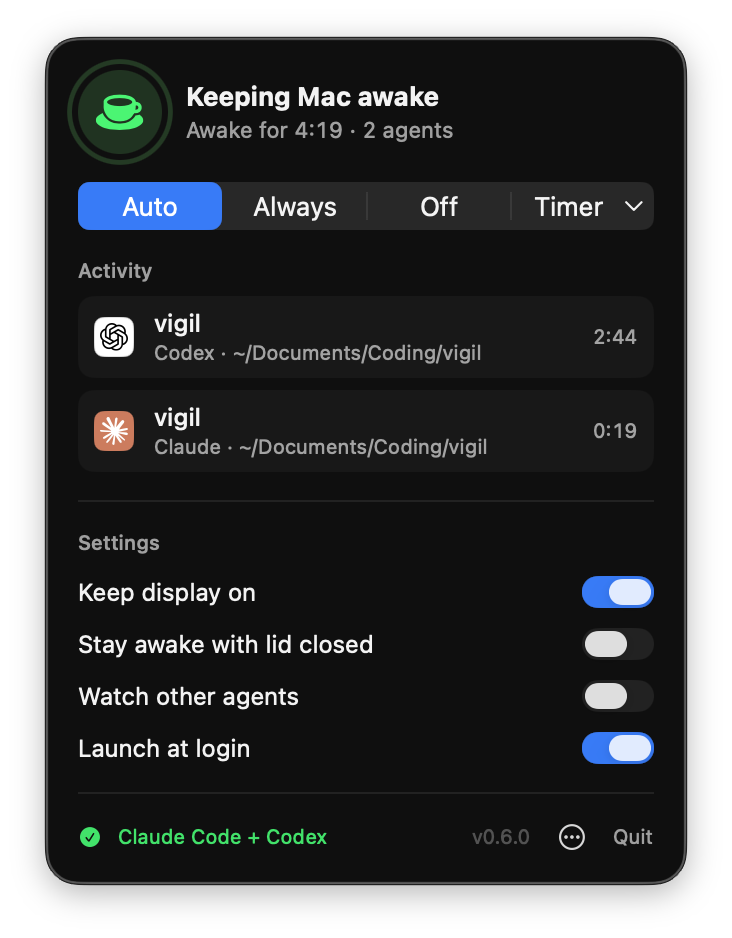

  

<h1 align="center">Vigil </h1>

  <b>Your Mac stays awake while your AI agent works, and sleeps as soon as it's done.</b>

  
   
  Free · macOS 13 Ventura or later · Apple silicon and Intel

  

---

You give Claude Code a big task and go make a coffee. When you come back, your Mac fell asleep ten minutes in and the job is half done. Or you keep the Mac awake "just in case", and it runs all night even though the agent finished at 1 a.m.

Vigil sits in your menu bar and handles both. It keeps your Mac awake exactly as long as an agent is working. Then it lets your Mac sleep normally again.

## Features

- **Knows when Claude and Codex are actually working.** Connect Claude Code or Codex with one click. Vigil keeps the Mac awake from the moment you send a prompt until the agent finishes replying, not just while it's open.
- **Works with other agents too.** Aider and Ollama are watched out of the box. You can add any other tool by name.
- **Your screen still locks.** Vigil keeps the Mac running but lets the display turn off and lock as usual. If you want the screen to stay on, turn on **Keep display on**.
- **Close the lid, keep working.** Turn on **Stay awake with lid closed** and your laptop keeps going in your bag while an agent works, then sleeps as soon as it's done. The cup turns red so you know it's on.
- **Timer.** Need the Mac awake for a download or a long build? Pick anything from 30 minutes to 8 hours. When time's up, Vigil goes back to normal.
- **Status at a glance.** The cup in your menu bar fills in while the Mac is kept awake. It also shows how many agents are working and how much time is left on a timer.
- **Updates itself.** New versions install quietly in the background, never in the middle of an agent's run.
- **Never touches your settings.** Vigil doesn't change your Mac's power settings, unless you turn on **Stay awake with lid closed**, and then only while an agent works. If Vigil quits, your Mac goes straight back to sleeping normally.

## Modes

| Mode | What it does |
|---|---|
| **Auto** | Awake only while an agent is working. This is the default. |
| **Always** | Awake until you switch it off. |
| **Off** | Your Mac sleeps as usual. |
| **Timer** | Awake for 30 min to 8 h, then switches back. |

## Get started

1. **[Download Vigil](https://github.com/okiro/vigil/releases/latest/download/Vigil.dmg)**, open the `.dmg` and drag Vigil into **Applications**.
2. Open Vigil. A cup appears in your menu bar.
3. Click the cup and press **Connect** to link Claude Code (and **Connect Codex** if you use Codex). If either is already open, restart it so it picks up the change.

That's it. Turn on **Launch at login** in the panel if you want Vigil to start every time you log in.

## Questions

<b>Will my Mac stay awake with the lid closed?</b>

 
Only if you turn on <b>Stay awake with lid closed</b>. The first time, macOS asks for your password, because keeping a closed Mac awake means switching off sleep for the whole system. Vigil does that only while an agent is working. As soon as the agent is done, it switches sleep back on, and a closed Mac goes to sleep right away. It also stops when the battery drops below 20% or the Mac gets too hot. The cup in the menu bar turns red while this is on.  Without it, closing the lid puts the Mac to sleep, unless it's plugged in and connected to an external display.

<b>Which AI tools does it work with?</b>

 
Claude Code and Codex work best: once connected, Vigil knows exactly when each reply starts and ends. If Codex says "Hooks need review" after you connect it, choose <b>Trust all and continue</b>. Aider and Ollama keep the Mac awake while they're running. To watch another tool, type its name under <b>Watch other agents</b> in the panel.

<b>What does "Connect" change?</b>

 
It adds a few small hooks to Claude Code's settings file (<code>~/.claude/settings.json</code>) or to Codex's (<code>~/.codex/hooks.json</code>), so the agent tells Vigil when it starts and stops working. Vigil saves a backup of the file before every change. You can disconnect any time from the ⋯ menu in the panel.

<b>An agent finished but Vigil still shows it as working.</b>

 
Hover over it in the panel and click ✕ to release it. Vigil also clears it automatically once Claude Code or Codex closes, or after 6 hours.

<b>Does Vigil collect any data?</b>

 
No. The only connection it makes is to GitHub, once a day, to check for updates.

<b>How do I uninstall it?</b>

 
Open the panel and, from the ⋯ menu, choose <b>Disconnect Claude Code</b>, <b>Disconnect Codex</b> and <b>Remove Lid Permission</b> (whichever are there), then <b>Quit</b>. Drag Vigil from Applications to the Trash.

---

Want to build Vigil yourself or see how it works? Head to <a href="DEVELOPMENT.md">DEVELOPMENT.md</a>.
